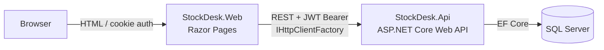

# StockDesk

> Multi-warehouse inventory management system with weighted average costing, optimistic concurrency with retries, and role-based access control.

[](https://github.com/edu-tech220/stockdesk/actions/workflows/ci.yml)


## 📌 Overview

StockDesk is inspired by real-world experience with API-connected inventory systems (warehouse stock control, receipts and issues, transfers between branches). Its focus is an accounting business rule that is easy to get wrong: **recalculating the weighted average cost** after every goods receipt and propagating it correctly through transfers between warehouses — all under real optimistic concurrency with retries.

## ✨ Key features & business rules

- **Stock per warehouse** (`Stock`): quantity and current average cost for every product/warehouse pair.
- **Inventory movements**, each with its own validation rules:
  - **Stock in** (`In`) — recalculates the weighted average cost.
  - **Stock out** (`Out`) — consumes stock at the current average cost; cannot take more than is available.
  - **Transfer** (`Transfer`) — atomic move between two *different* warehouses.
- **Kardex** (movement ledger): paginated, auditable history filterable by product, warehouse and date range.
- **Low-stock alerts**: products whose quantity is at or below their reorder point.
- **JWT authentication with two roles**: `Admin` (manages catalogs and users) and `Operator` (records movements and runs queries).

## 🏗️ Architecture

Two independent services that communicate over HTTP, forming a simple microservice architecture:



- **StockDesk.Api** — REST API built with ASP.NET Core, EF Core, JWT authentication and role-based authorization. It is the only layer that talks to the database.
- **StockDesk.Web** — classic server-rendered Razor Pages site (no SPA, no heavy JavaScript). Server-side page handlers call the API through `IHttpClientFactory` and forward the JWT (stored inside the site's own authentication cookie) in the `Authorization` header. The browser never sees or handles the JWT directly and never makes AJAX calls to the API.
- Both projects are deployed independently (two Dockerfiles, two services in `docker-compose.yml`), as decoupled services should be.

## 🧠 Technical decisions

### Weighted average costing

Recording a stock-in (`POST /api/movements/in`) with a quantity and unit cost recalculates the average cost of the affected `Stock`:

```
newAverage = (currentQty * currentAverage + inQty * inUnitCost)
             / (currentQty + inQty)
```

If no `Stock` exists yet for that product/warehouse, it is created with `Quantity = 0` and `AverageCost = 0`, so the resulting average equals the unit cost of the first receipt.

**Stock-outs** (`POST /api/movements/out`) are valued at the current average cost without changing it, and the API rejects any attempt to take out more than the available quantity (`409 Conflict` with `ProblemDetails`).

**Transfers** (`POST /api/movements/transfer`) are atomic (a single database transaction): they subtract from the source warehouse without altering its average cost, and apply the same weighted-average formula on the destination warehouse using the source's average cost as the "incoming cost". Source and destination must be different.

### Optimistic concurrency (RowVersion + retry)

The `Stock` table has a `RowVersion` column (`[Timestamp]`, mapped to `rowversion` on SQL Server) that EF Core uses as a concurrency token. If two concurrent movements try to update the same `Stock`, EF Core throws `DbUpdateConcurrencyException` when saving the second one.

`MovementService` wraps every operation (in/out/transfer) in a *read-modify-write with retry* pattern: on a concurrency conflict it detaches the tracked entities, re-reads the current `Stock` and recalculates from scratch, up to 3 attempts. If retries are exhausted it returns `409 Conflict` (`ProblemDetails`).

This is verified by an integration test (`ConcurrencyTests.ConcurrentStockIn_OnSameProductWarehouse_NoLostUpdates`) that fires 10 concurrent stock-ins on the same product/warehouse with `Task.WhenAll` and asserts that the final quantity is exactly the expected sum (no lost updates), plus an equivalent test for concurrent stock-outs that verifies there is no overselling.

> **Note on SQLite in tests:** SQLite has no native `rowversion` type. For the tests (which use in-memory SQLite) the `DbContext` manually assigns a new 8-byte token on every insert/update of `Stock` (see `StockDeskDbContext.StampSqliteRowVersions`), reproducing the "changes on every write" behavior of SQL Server's `rowversion` without requiring external infrastructure for the tests.

### Pagination without N+1

The stock, low-stock and kardex endpoints return paginated results (`page` / `pageSize`, capped at 200) and project directly to DTOs with `Select(...)` (including product and warehouse names) instead of using `Include` and materializing full entities. This avoids the N+1 problem and lets EF Core generate a single SQL query with the required `JOIN`s.

### JWT + PBKDF2 + roles

- Passwords are stored with **PBKDF2** (`Rfc2898DeriveBytes.Pbkdf2`, SHA-256, 100,000 iterations, random 128-bit salt), with no external dependencies.
- Authentication uses JWT Bearer (`Microsoft.AspNetCore.Authentication.JwtBearer`).
- Role-based authorization: `Admin` can create products, warehouses and users; `Admin` and `Operator` can record movements. Both roles can query stock, the kardex and low-stock alerts.
- `DbSeeder` creates a development admin user: **username `admin`, password `Admin123!`**. This is only meant to get the system running locally — **change it (or create a new user and delete this one) before using the project in any real environment.**

### Errors as ProblemDetails

`ExceptionHandlingMiddleware` translates:

- `BusinessRuleException` → `400` / `409` depending on the case (e.g. insufficient stock, duplicate SKU, source == destination in transfers).
- `ConcurrencyConflictException` (retries exhausted) → `409`.
- Any other unhandled exception → `500`.

All responses use the standard ASP.NET Core `application/problem+json` format.

### EF Core migrations

The project uses real EF Core migrations (not just `EnsureCreated`). `dotnet-ef` is installed as a local tool (see `dotnet-tools.json`) and the initial migration was generated with:

```bash
dotnet tool run dotnet-ef migrations add InitialCreate \
  --project src/StockDesk.Api/StockDesk.Api.csproj \
  --startup-project src/StockDesk.Api/StockDesk.Api.csproj \
  -o Data/Migrations
```

The output lives in `src/StockDesk.Api/Data/Migrations/`. On API startup (`Program.cs`):

- If the configured provider is **SQL Server** (normal development, Docker, production), `Database.Migrate()` applies those migrations.
- If the provider is **SQLite** (used only by `WebApplicationFactory` in the integration tests, because the generated migrations are SQL Server-specific), `Database.EnsureCreated()` is used instead. To be explicit about the scope: **the tests do not run against the SQL Server migrations**; they run against an equivalent schema created with `EnsureCreated()`.

## 🧰 Tech stack

| Layer | Technology |
|---|---|
| Backend | .NET 8, ASP.NET Core Web API, Swashbuckle (Swagger) |
| Frontend | ASP.NET Core Razor Pages, cookie authentication, `IHttpClientFactory` |
| Data | Entity Framework Core 8 (migrations via `dotnet-ef` local tool), SQL Server 2022 |
| Security | JWT Bearer, PBKDF2-SHA256 password hashing, role-based authorization |
| Testing | xUnit, `WebApplicationFactory`, SQLite in-memory |
| DevOps | Docker, Docker Compose, GitHub Actions |

## 🚀 Getting started

### Option 1: Docker Compose (everything at once)

```bash
docker compose up --build
```

| Service | URL |
|---|---|
| Web frontend | http://localhost:5081 |
| API | http://localhost:5080 |
| Swagger UI | http://localhost:5080/swagger |
| SQL Server | `localhost,1433` |

Log in with `admin` / `Admin123!`. The passwords and JWT key in `docker-compose.yml` are sample values **for development only** (clearly marked in the file); any use outside your local machine must replace them with real secrets injected securely.

### Option 2: Local with `dotnet run` (requires a reachable SQL Server)

1. Start a SQL Server instance — for example, only the database service from the compose file:
   ```bash
   docker compose up sqlserver -d
   ```
   or point `ConnectionStrings:Default` in `src/StockDesk.Api/appsettings.json` (or environment variables) to your own instance.
2. Backend — the web app expects the API at `http://localhost:5080` by default (`Api:BaseUrl`), so run it on that port:
   ```bash
   dotnet run --project src/StockDesk.Api/StockDesk.Api.csproj --urls http://localhost:5080
   ```
   The API applies migrations automatically on startup and seeds the `admin` / `Admin123!` user. Swagger is available at `/swagger` in the Development environment.
3. Frontend (in another terminal):
   ```bash
   dotnet run --project src/StockDesk.Web/StockDesk.Web.csproj
   ```
   The site listens on http://localhost:5093. If your API runs elsewhere, set `Api:BaseUrl` in `src/StockDesk.Web/appsettings.json` (or the `Api__BaseUrl` environment variable).

## 🧪 Running tests

```bash
dotnet test StockDesk.sln
```

**17 xUnit tests**, all running without SQL Server or Docker (in-memory SQLite + `WebApplicationFactory<Program>`). They cover:

- Weighted average costing (first receipt and successive receipts).
- Stock-out rejected for insufficient stock (`409`).
- Correct atomic transfer (subtracts from source, recalculates destination average).
- Transfer rejected when source and destination are the same warehouse.
- Transfer rejected for insufficient stock at the source.
- Optimistic concurrency: concurrent movements (`Task.WhenAll`) on the same `Stock`, verifying no updates are lost (for both stock-ins and stock-outs).
- Low-stock alerts (only products at or below their reorder point).
- Paginated kardex (descending by date, correct total count).
- Authentication: valid login returns a JWT, invalid login returns `401`, `Operator` gets `403` when creating a product, `Admin` can create it (`201`).

GitHub Actions (`.github/workflows/ci.yml`) restores, builds and tests the solution on every push and pull request to `main`.

### Manual testing via Swagger

1. Start the API (`dotnet run` or Docker Compose).
2. Open `http://localhost:5080/swagger`.
3. Call `POST /api/auth/login` with `{"username": "admin", "password": "Admin123!"}` to obtain a JWT.
4. Click **Authorize** and enter `Bearer <token>` to try the protected endpoints.

### Manual testing via the web app

1. Start the API and the web app (locally or with Docker Compose).
2. Open the web app (`http://localhost:5081` with Docker Compose) and sign in with `admin` / `Admin123!`.
3. From the menu you can create warehouses and products (as Admin), record stock-ins/outs/transfers, and view the stock dashboard, a product's kardex and the low-stock alerts.

## 🔌 API endpoints

All endpoints except login require a JWT (`Authorization: Bearer <token>`).

| Method | Route | Access | Description |
|---|---|---|---|
| POST | `/api/auth/login` | Anonymous | Authenticate and receive a JWT |
| POST | `/api/auth/users` | Admin | Create a user |
| GET | `/api/products` | Authenticated | List products |
| POST | `/api/products` | Admin | Create a product |
| GET | `/api/warehouses` | Authenticated | List warehouses |
| POST | `/api/warehouses` | Admin | Create a warehouse |
| GET | `/api/stock` | Authenticated | Stock per product/warehouse (paginated, filter by `warehouseId`, `productId`) |
| GET | `/api/stock/low-stock` | Authenticated | Products at or below reorder point (paginated, filter by `warehouseId`) |
| POST | `/api/movements/in` | Admin, Operator | Record a stock-in and recalculate average cost |
| POST | `/api/movements/out` | Admin, Operator | Record a stock-out at current average cost |
| POST | `/api/movements/transfer` | Admin, Operator | Atomic transfer between warehouses |
| GET | `/api/movements` | Authenticated | Kardex (paginated, filter by `productId`, `warehouseId`, `from`, `to`) |

## 📁 Project structure

```
StockDesk.sln
├── .github/workflows/ci.yml       # Build + test on GitHub Actions
├── Dockerfile.api
├── Dockerfile.web
├── docker-compose.yml             # sqlserver + api + web
├── dotnet-tools.json              # dotnet-ef local tool
├── src/
│   ├── StockDesk.Api/             # REST API (.NET 8, EF Core, JWT, Swagger)
│   │   ├── Auth/                  # JWT generation, PBKDF2 password hashing
│   │   ├── Controllers/           # Auth, Products, Warehouses, Stock, Movements
│   │   ├── Data/                  # DbContext, seeder, migrations
│   │   ├── Domain/                # Product, Warehouse, Stock, StockMovement, User
│   │   ├── Dtos/
│   │   ├── Middleware/            # ProblemDetails exception handling
│   │   └── Services/              # MovementService (costing + concurrency), AuthService
│   └── StockDesk.Web/             # Razor Pages (IHttpClientFactory, cookie auth)
│       ├── ApiClient/             # Typed API client
│       ├── Models/
│       └── Pages/                 # Stock, Movements, Kardex, LowStock, Products, Warehouses, Account
└── tests/
    └── StockDesk.Api.Tests/       # xUnit (SQLite in-memory, WebApplicationFactory)
```

## 🔐 Security and sample values

The seeded `admin` password, the SQL Server password and the JWT signing key in this repository (`appsettings.json`, `docker-compose.yml`) are **development values**, explicitly marked as such. Replace them with real secrets managed securely (deployment environment variables, a secrets manager, etc.) before any use outside a local development machine.
